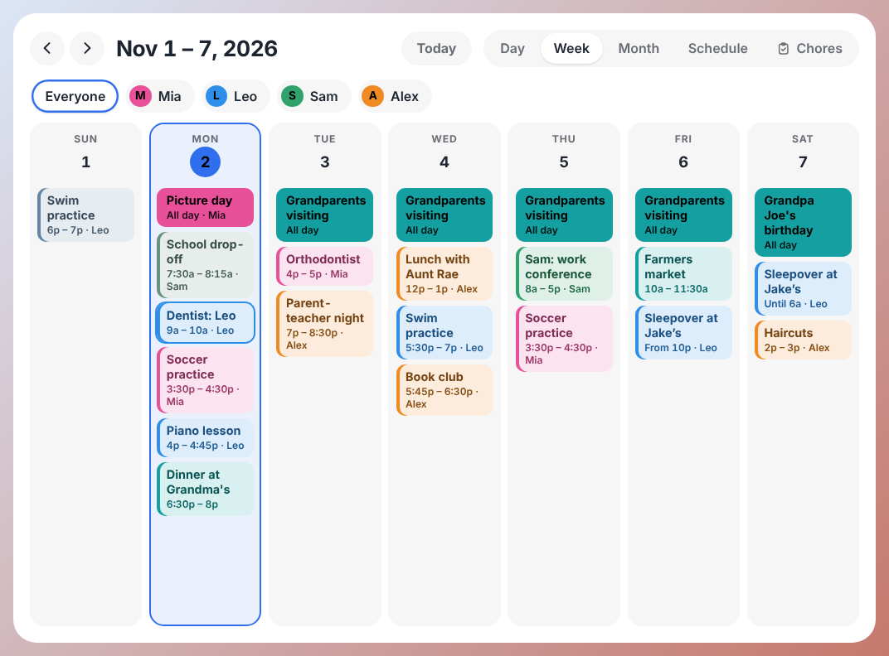
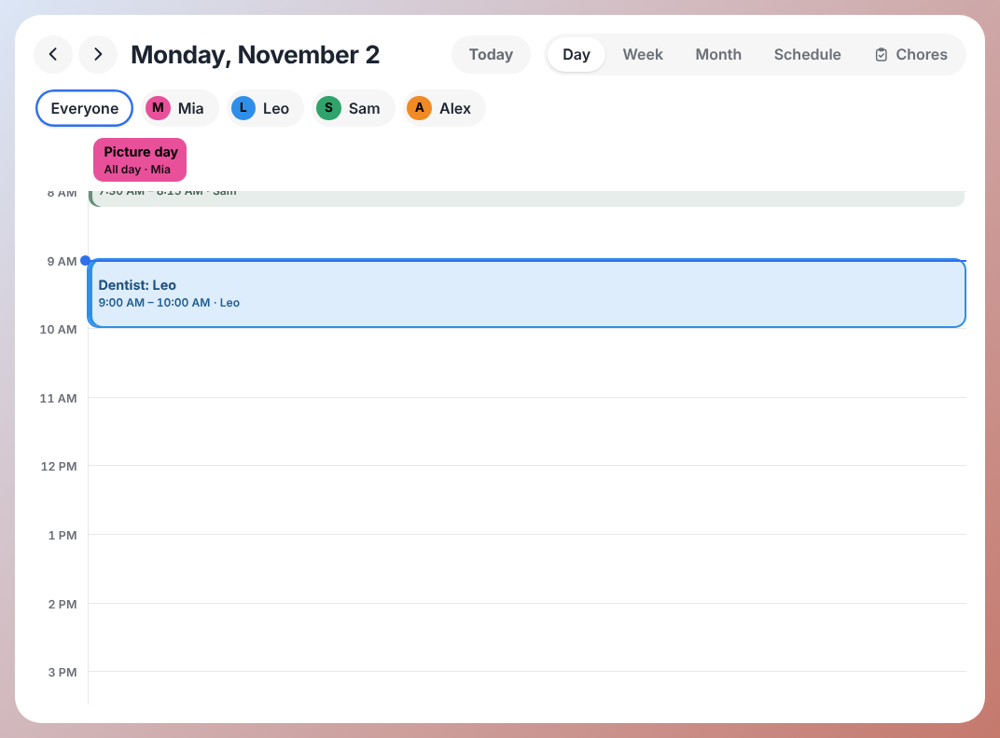
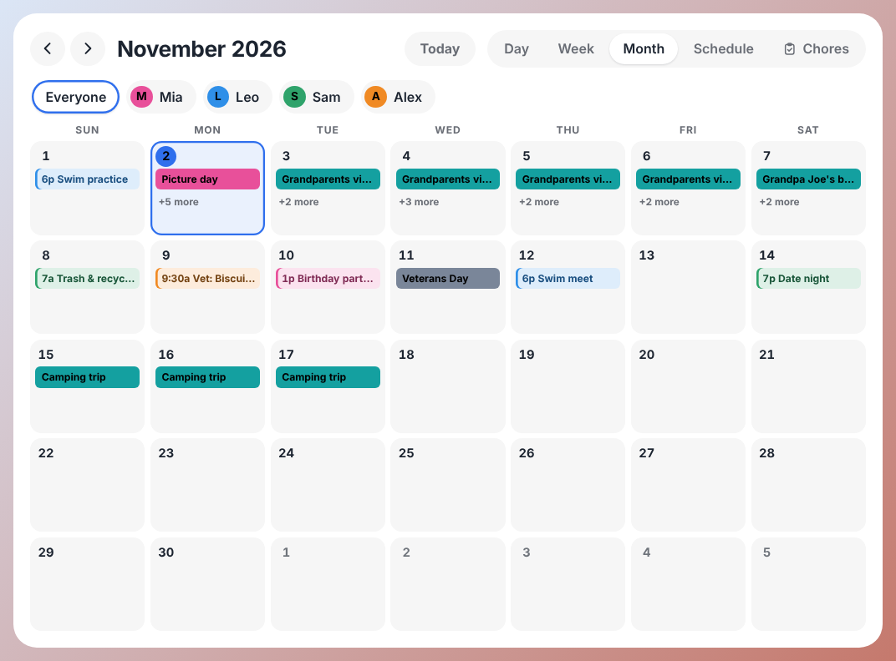
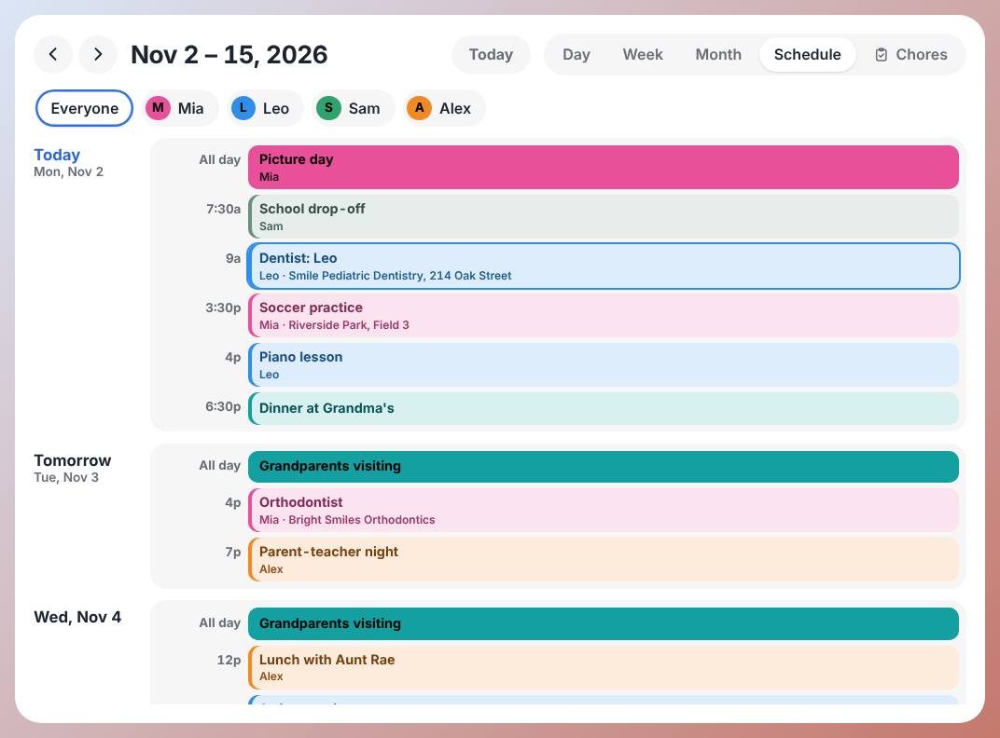
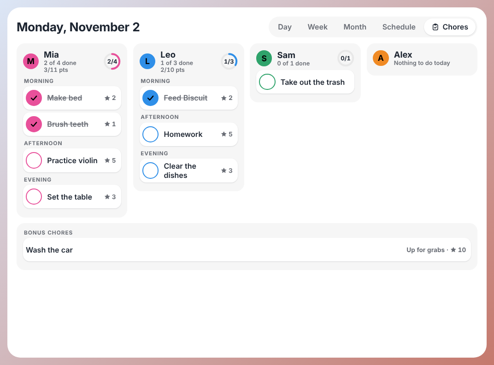
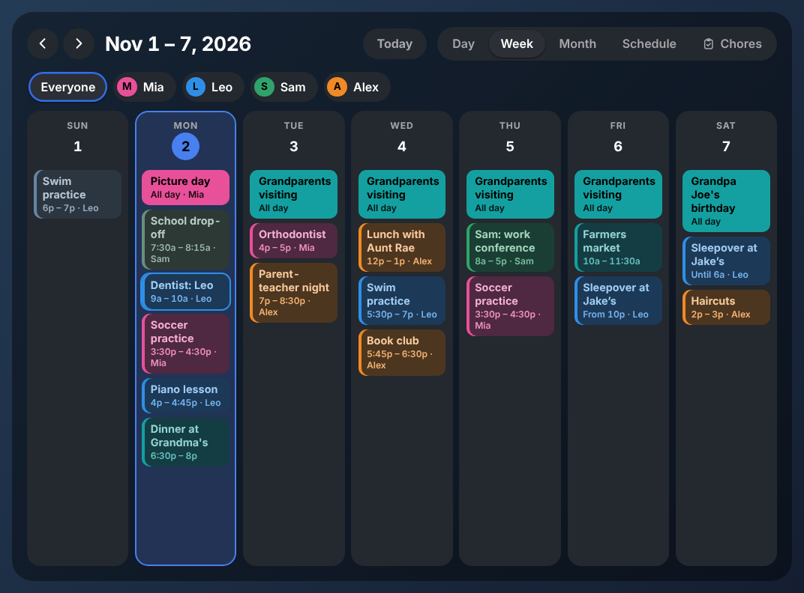
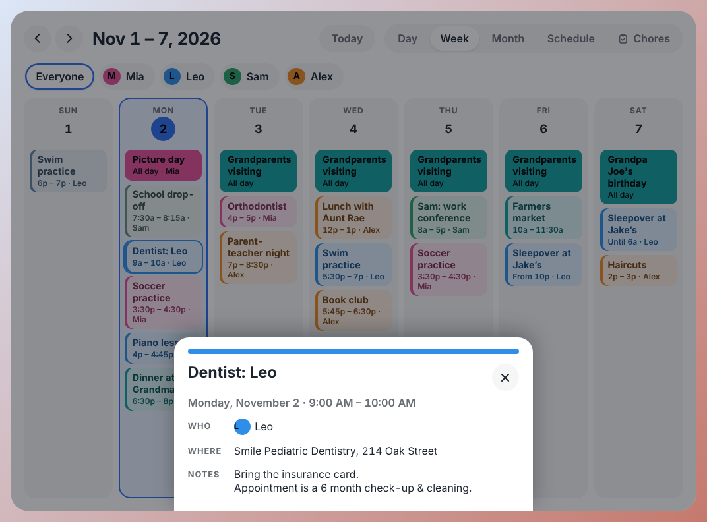
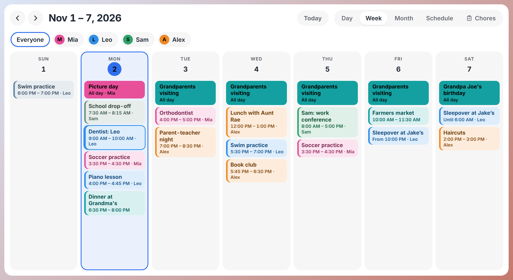
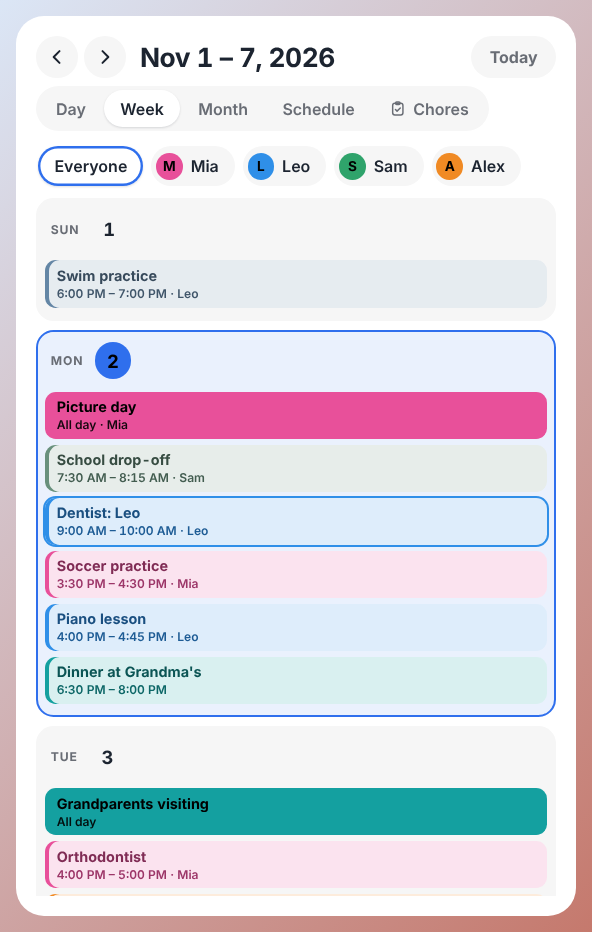

# Family Wall Calendar

A bright, touch-friendly **family calendar and chore chart** plugin for
[Home Screens](https://homescreens.dev), designed for a wall-mounted touchscreen.
It is inspired by the look and feel of family wall calendars: soft white tiles,
pastel event cards in each family member's color, big round buttons, and a
tap-to-tick chore list. The design is original; it uses no third-party assets or branding.



> The screenshots show **synthetic sample data** in a test harness, not a real
> Home Screens instance. See [What has and has not been tested](#what-has-and-has-not-been-tested).

## What you get

| | |
|---|---|
| **Week** (default) | Seven tall day columns of pastel event cards. Today is highlighted. |
| **Day** | An hour-by-hour timeline with an all-day strip, a "now" line, and side-by-side overlapping events. |
| **Month** | The classic wall-calendar grid. Tap a day to open it. |
| **Schedule** | A scrolling list of the next two weeks, grouped by day ("Today", "Tomorrow", ...). |
| **Chores** | One card per person with today's chores, progress ring and points. Tap a chore to tick it off. |
| **Family filter** | Tap a person (or a calendar) to see just their events. Shared family events stay visible. |
| **Event details** | Tap any event for a bottom sheet with who, where and notes. |
| **Wall behavior** | After a quiet spell it returns to today and your starting view. |

Also: light and dark themes, a 12/24-hour clock that follows your household setting,
Sunday- or Monday-first weeks, any language your browser formats (dates and times use
`Intl`), and layouts that adapt from a small portrait box to a 15-inch landscape screen.

<details>
<summary>More screenshots</summary>

| | |
|---|---|
|  |  |
|  |  |
|  |  |
|  |  |

</details>

## Install

You need a Home Screens hub (this was built against the `1.15.x` source; the manifest asks for `1.7.1` or newer).

### Option A: Install from URL (recommended)

The plugin ships as a ready-made tarball: [`release/plugin.tar.gz`](release/plugin.tar.gz)
(SHA-256 in [`release/plugin.tar.gz.sha256`](release/plugin.tar.gz.sha256)).

1. Put `plugin.tar.gz` somewhere your hub can fetch over **HTTPS**. If this repository is public,
   the raw GitHub address works:
   `https://raw.githubusercontent.com/cyberbandit1998/homescreens/<branch>/release/plugin.tar.gz`
   (a private repository will not, because the hub cannot sign in to GitHub; host the file anywhere else instead).
2. In the Home Screens **editor**, open the plugin browser, go to **Browse**, and choose **Install from URL...**.
3. Paste the address and install.

### Option B: Copy it onto the hub

Use this if the hub cannot reach an HTTPS address for the file. On the hub:

```bash
cd <your home-screens folder>/data/plugins
tar -xzf /path/to/plugin.tar.gz          # creates family-wall-calendar/
```

Then add this entry to the `plugins` list in `data/plugins/installed.json`
(create the file as `{ "schemaVersion": 1, "plugins": [ ... ] }` if it does not exist), and reload the editor:

```json
{
  "id": "family-wall-calendar",
  "version": "1.0.1",
  "installedAt": "2026-11-02T00:00:00.000Z",
  "enabled": true,
  "moduleType": "family-wall-calendar"
}
```

### Option C: Try it without installing (editor preview only)

Serve this folder with CORS and paste its address into the editor's **Developer** tab:

```bash
npm install && npm run build
npx serve . --cors -l 5555        # then paste http://<this-machine>:5555 in the Developer tab
```

A dev plugin shows **only in the editor tab**; the real wall keeps showing the installed copy.

## Set it up

1. In the editor, add the module **Family Wall Calendar** (palette category *Personal*) to a screen and resize it to fill the screen.
   It starts white with rounded corners; the usual Style panel (background, text size, corners, border, shadow) still works.
2. **Calendars:** Settings > Calendar. Add a Google or iCloud account or an iCal link, exactly as for the built-in calendar.
3. **Family colors:** Settings > Family, then Settings > Calendar > *Whose calendars?*. A calendar given to someone takes
   their color and shows up in the family filter. Calendars nobody owns count as shared by the whole house. With no family
   set up, the filter lists your calendars instead.
4. **Chores:** add them from the Home Screens remote, as usual. They appear under the **Chores** tab.

## Settings

Edit these in the module's panel in the editor.

| Setting | Default | What it does |
|---|---|---|
| Starting view | Week | The view shown at start-up and after the wall has been idle. |
| Week starts on | Sunday | Sunday or Monday. |
| Show weekends | On | Off gives a Monday to Friday week view. |
| Events per day in Month view | 4 | Extra events collapse into "+N more" (it also limits itself to what fits). |
| Day view starts / ends at | 6 / 22 | The hours drawn; wider if an event falls outside them. |
| Show family filter | On | The row of people (or calendars) above the calendar. |
| Show Chores tab | On | Reads today's chores from the Home Screens chore chart. |
| Tap to tick off chores | On | Turn off for a read-only chore list. |
| Theme | Auto | Auto picks light or dark from the module's background color. |
| Accent color | `#2f6fed` | Today, the Today button, and the selected family member. |
| Return to today after | 120 s | 0 keeps whatever was last opened. |

## How it works with Home Screens

It is a normal Home Screens plugin: a single script (`dist/bundle.js`) plus `manifest.json`,
loaded by the hub, with React supplied by the host. It talks only to your own hub:

| Needs | From |
|---|---|
| Events | `GET /api/calendar` with a window of last month to next month, through the SDK's `useFetchData`, so it uses the wall's own credentials and caching. |
| Family members and calendar owners | The `people` prop the host passes to modules that declare `dataRequirements: ["calendar"]`. |
| Chores | `GET /api/chores/today` and `GET /api/family`. |
| Ticking a chore | `POST /api/chores` (the same open-on-the-LAN route the kids' chore page uses). |

It declares **no external domains and no secrets**, and never touches the plugin proxy. It only reads calendars;
you cannot add or edit events on the wall.

Dates are handled as plain "wall dates" in the household's time zone (not the kiosk's), so a Raspberry Pi left on UTC
still puts a 9 pm event on the right day.

## Development

```bash
npm install                # uses legacy-peer-deps via .npmrc (works around an npm 10 resolver bug with Vitest's peers)
npm run check              # typecheck + unit tests + build
npm run browser-check      # build, then drive the bundle in real Chromium (needs Playwright's browser)
npm run shots              # screenshots of every state into harness/out/shots
npm run package            # build release/plugin.tar.gz (+ .sha256) and verify it extracts and loads
```

```
manifest.json            plugin metadata, config schema, defaults
src/index.tsx            the component the host mounts
src/lib/                 pure logic: dates, events, people, chores, colors, theme (all unit-tested)
src/ui/                  views, header, family filter, event sheet, chores, styles
src/host-style.ts        the host's module frame, from the official plugin template
src/hs-*.d.ts            SDK typings (from the template; useFetchData corrected to match the host)
harness/                 a stand-in Home Screens display page + synthetic family, for browser testing
test/                    Vitest: logic and server-side rendering of every view
scripts/                 browser-check, shots, package, harness build
```

All text lives in `src/strings.ts`. Sizes are in `em`, so the host's Text size slider scales everything.

## What has and has not been tested

**Tested (automated):** 94 unit tests (time zones, all-day and overnight events, overlap layout, colors and contrast,
config handling, chore parsing, rendering of every view and state). 28 behavior checks in real Chromium,
running in a UTC browser to mimic a stock Raspberry Pi: navigation, family filter, event sheet and focus,
chore ticking (including a failed save), idle reset, empty and error states, other languages, and an
axe accessibility scan (WCAG 2.x A and AA, 2.2) of every view in both themes.

**Not tested: a real Home Screens hub.** The development environment could not run the real app, so the plugin has never
been loaded by the real plugin loader or talked to a real hub. The test harness imitates the loader, the SDK and the
`/api/*` answers, based on the Home Screens documentation and its `1.15.0-beta.0` source. After installing, please check:

1. The module appears in the palette and renders on a screen.
2. Events load (the window is requested as `/api/calendar?timeMin=...&timeMax=...`).
3. Family colors and the filter match Settings > Family. This depends on the host passing the `people` prop.
4. Ticking a chore updates the chore chart, and the Chores tab reads sensibly. The shape of `GET /api/family` was not
   confirmed against a live hub; if names or colors are missing on the Chores tab, that is where to look.
5. Your Style panel changes (text size, background, corners) behave as expected.

Not included: creating or editing events, Lists, Meals and Photos (use Home Screens' own modules beside it),
and translations (every string is in `src/strings.ts`, ready to translate).

## License

MIT. `src/host-style.ts` and the typings in `src/hs-*.d.ts` come from the official
[Home Screens plugin template](https://github.com/home-screens/home-screens-plugin-template).
